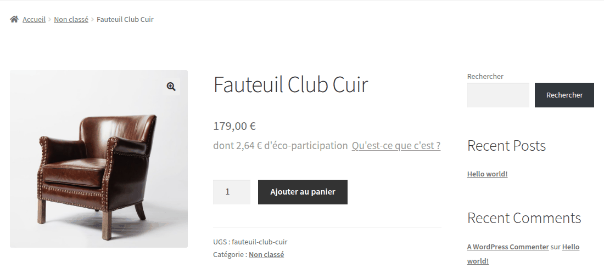
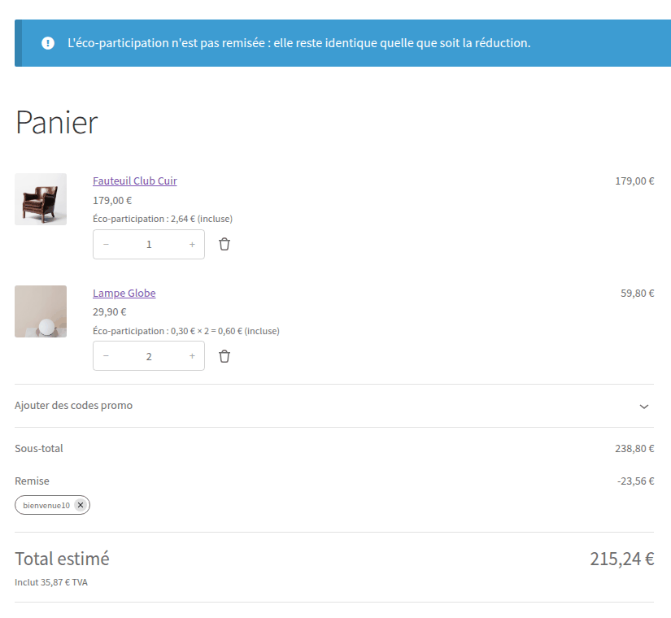
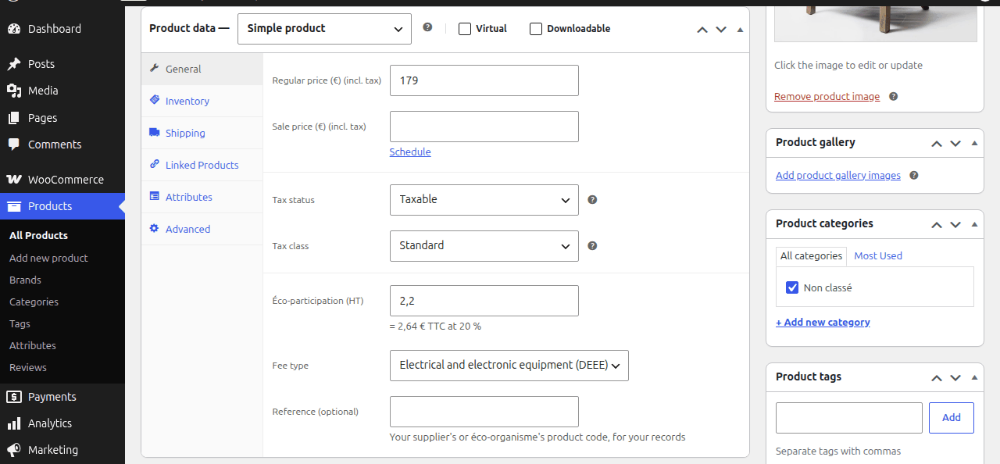
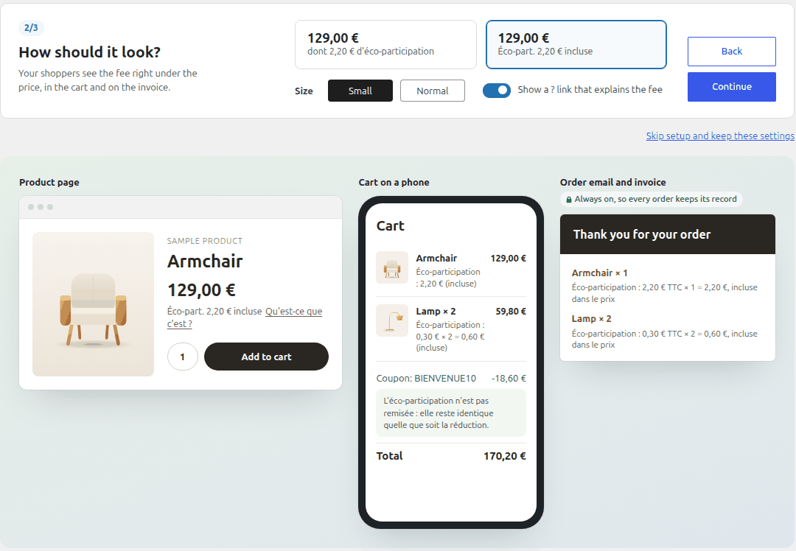
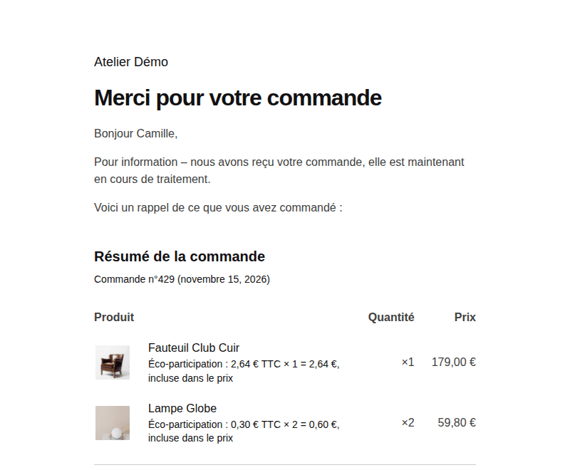

# Ecopart – Éco-participation pour WooCommerce

**Ce que c'est :** une extension WooCommerce gratuite qui affiche « dont X € d'éco-participation » sous le prix, dans le panier, au paiement, dans l'e-mail et sur la commande.

**Pour qui :** les boutiques WooCommerce qui vendent en France des appareils électriques et électroniques (DEEE) ou des meubles (DEA).

**Comment l'utiliser :** 1. téléchargez le zip ci-dessous et téléversez-le dans WordPress ; 2. suivez l'assistant de WooCommerce → Éco-participation ; 3. saisissez le montant de chaque produit.

## Ce que votre boutique y gagne

- **Des clients rassurés :** la ligne d'éco-participation qu'ils attendent, sous chaque prix, dans le style de votre thème.
- **Des factures justes :** chaque ligne de commande garde le montant vendu, et les codes promo ne réduisent jamais la contribution.
- **Prête en deux minutes :** un assistant en trois étapes avec un aperçu en direct de la fiche produit, du panier mobile et de l'e-mail de commande.
- **Moins d'oublis :** une colonne « Éco-part. » dans Produits, un filtre des produits sans montant, et une alerte quand un prix est inférieur à sa contribution.
- **Compatible avec votre boutique :** panier et paiement classiques ou en blocs, HPOS, prix TTC ou HT.

Gratuit, sans essai et sans limite. Ecopart n'envoie rien vers l'extérieur : vos données restent chez vous.

## En images

*La fiche produit : le montant sous le prix, comme chez les grandes enseignes.*

*Le panier : l'éco-participation reste visible, et les codes promo ne la réduisent pas.*

*Le montant et le type de contribution, saisis dans la fiche du produit.*

*L'assistant en trois étapes, avec un aperçu en direct.*

*L'e-mail de commande envoyé au client.*

## Télécharger et installer

1. Téléchargez **[ecopart.zip](https://github.com/Facilo-es/ecopart/releases/latest/download/ecopart.zip)** (dernière version).
2. Dans WordPress, allez dans **Extensions → Ajouter → Téléverser une extension**, choisissez le zip et activez-le.
3. Ouvrez **WooCommerce → Éco-participation** et suivez l'assistant.

## Ecopart Pro : des centaines de montants à jour en une minute

- Import du fichier CSV ou Excel de votre fournisseur, avec aperçu, essai à blanc et bouton d'annulation.
- Montants par catégorie ou par poids.
- Total de l'éco-participation sur les factures et les e-mails.
- Reprise gratuite de l'ancien appareil proposée au paiement.
- Rapport des unités et montants par type de contribution.

**49 € par an pour une boutique, ou 129 € par an pour 10 boutiques.** [Obtenir Ecopart Pro](https://checkout.freemius.com/plugin/45099/plan/79503/) · Satisfait ou remboursé pendant 14 jours.

## Questions fréquentes

**Ça marche avec les produits variables ?**
Oui. Chaque variation a son propre champ de montant. Laissez-le vide pour reprendre le montant du produit parent, ou mettez 0 pour une variation sans contribution.

**Et si ma boutique vend en plusieurs devises ?**
Les montants se saisissent dans la devise de votre boutique, et Ecopart ne les convertit pas. Il est fait pour les boutiques en euros et n'a pas été testé avec les extensions multidevises. Chaque commande garde le montant et la devise de la commande.

**DEEE ou meubles (DEA) ?**
Les deux. Pour chaque produit, choisissez le type : équipement électrique et électronique (DEEE), ameublement (DEA) ou autre. Le client voit la même mention, et le type est gardé sur chaque ligne de commande. Le rapport de Pro donne les totaux par type.

**Ecopart fournit-il les montants officiels ?**
Non. Aucun montant n'est inclus. Reprenez ceux de la facture de votre fournisseur ou du barème de votre éco-organisme (Ecosystem, Ecologic, Ecomaison…).

**Le paiement mentionne un essai. Y en a-t-il un ?**
Non. Ecopart Pro n'a pas d'essai : la version gratuite sert à l'essayer. Toute mention d'essai sur la page de paiement est un texte générique de Freemius, le service de paiement, et ne s'applique pas ici. Vous avez 14 jours pour être remboursé.

**Pro continue-t-il de fonctionner si je ne renouvelle pas ?**
Oui. Tout continue de fonctionner. Vous ne recevez simplement plus les mises à jour ni le support.

**Comment arrivent les mises à jour ?**
Pour l'instant, par les nouvelles versions publiées ici sur GitHub : téléchargez le nouveau zip et téléversez-le à la place de l'ancien. Une fois Ecopart publié sur wordpress.org, les mises à jour arriveront dans votre tableau de bord WordPress comme pour toute extension. Les mises à jour de Pro arrivent par votre licence, dans WordPress.

**Qui le fait ?**
Facilo, un petit studio en Espagne. Écrivez-nous à support@facilo.es.

## Important

Ecopart affiche les montants que vous saisissez. Il ne fournit aucun montant et ne constitue pas un conseil juridique. Vérifiez vos montants auprès de votre fournisseur ou de votre éco-organisme.

Support : support@facilo.es · [facilo.es](https://facilo.es) · Licence GPLv2 ou ultérieure.
